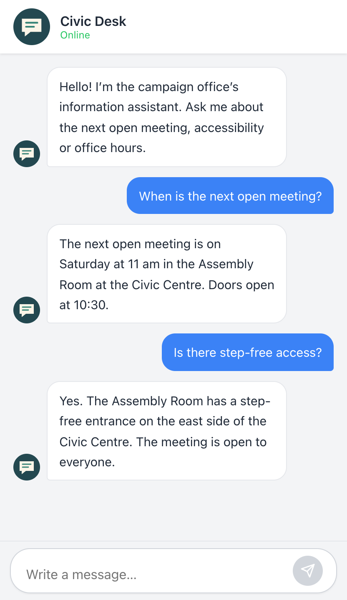

# Civic Desk · Multichannel campaign chatbot

A political campaign’s information desk for visitors on the web, WhatsApp and Telegram. Each channel keeps its own conversation history, so a follow-up question can refer back to the previous answer.

<a href="docs/web-chat.png"></a>

## Try the chat

With Docker Compose installed and access to this private repository:

```sh
git clone https://github.com/Dror-Bengal/civic-desk-chatbot.git
cd civic-desk-chatbot
docker compose up --build -d
```

Open [Civic Desk on your computer](http://localhost:18790). Ask **When is the next open meeting?**, then **Is there step-free access?**. Refresh the page to reopen the conversation. The default responder uses a small fictional campaign office FAQ and runs without service keys. The screenshot shows the original web client with neutral branding and sample replies.

## What runs where

| Channel | Incoming message | Reply |
| --- | --- | --- |
| Web | A visitor types in the original browser chat | The answer appears in the thread. A browser cookie identifies the conversation. |
| WhatsApp | A signed Meta webhook delivers the incoming message | The Cloud API sends the reply to the sender. Delivery receipts are retained for seven days to handle repeats. |
| Telegram | A bot polls for private chat updates | The Bot API sends the reply to the same chat. The polling cursor is saved across restarts. |

The three adapters feed a shared message pipeline. MongoDB stores users, conversations and messages in a local volume. The web client restores the last 20 messages. The original messaging adapters also normalize attachments. The optional Gemini responder can process supported media and document text.

## Test all three channels locally

```sh
docker compose exec bot npm test
```

The integration tests use a temporary database. They open a web session, deliver a signed WhatsApp event, retry a failed outgoing reply, and run Telegram polling and outbound delivery against local HTTP servers. The automated tests use fictional senders and do not contact Meta, Telegram or Gemini.

## Connect your own services

The default Compose configuration enables the web channel and binds its port to loopback. Set optional credentials in your shell or an untracked `.env`, then run `docker compose up -d` to apply them.

| Feature | Settings |
| --- | --- |
| Gemini replies | Set `REPLY_MODE=gemini`, `GEMINI_API_KEY` and `GEMINI_MODEL` to a model available to your account. The selected service receives the user message, recent turns and supported attachments. |
| WhatsApp Cloud API | Set `WHATSAPP_ENABLED=true`, `WHATSAPP_PHONE_NUMBER_ID`, `WHATSAPP_APP_SECRET`, `WHATSAPP_VERIFY_TOKEN`, `WHATSAPP_ACCESS_TOKEN` and the `WHATSAPP_API_VERSION` supported by your Meta app. Configure an HTTPS callback to `/webhook/whatsapp` and subscribe the app to messages on the configured phone number. |
| Telegram Bot API | Set `TELEGRAM_ENABLED=true` and `TELEGRAM_BOT_TOKEN` for a bot using long polling. Start a private chat with the bot. Run a single polling instance per token. |

Edit [the office brief](config/brief.json) to replace the fictional details. The local FAQ covers meetings, registration, access and office hours. The Gemini adapter uses the same brief. Run `docker compose up --build -d` after changing the file. Use `docker compose down` to stop the app and retain its data.

## Source

[Web interface](views/chat.ejs) · [Browser client](public/js/chat-client.js) · [WhatsApp and Telegram transports](channels/providers.js) · [Shared conversation pipeline](core/orchestrator.js) · [Reply providers](core/llmCore.js)
